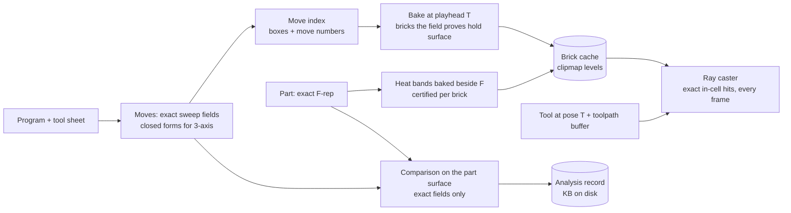

# icam-sim: the stock visualization engine

**The stock is drawn from a sparse cache of its exact field, baked at the playhead and ray-cast
every frame. It is never meshed, and nothing the comparison reports is read from the cache.**

Decided 2026-10-25 (Derek: "This now finally sounds like the architecture I wanted all along for
a visualization engine"). This replaces the move-by-move skin (`icam_sweep::skin` with
`icam_sweep::envelope`) and the meshing prototype (`icam_sweep::bake`). Both stay in the tree until
the engine below replaces them, as references and as tests of the fields.

See also: `ARCHITECTURE_AND_ROADMAP.md` (sections 4 to 6 on discretized stock; see Open questions
for a correction to sections 3 and 4), `CONTRIBUTING.md` decision 9 (GPU first).

---

## 1. Requirements

These come from Derek and are the gates every piece below is measured against.

1. **Whole nests in seconds.** A 2.4 m sheet program has about 106,000 moves.
2. **No holes in the drawn stock, by construction.** A hole is any place the drawing shows air
   where the field says material, including features thinner than a cache cell (onion skins).
3. **Exact comparison.** Gouge depth, stock left, areas and volumes come from the exact fields.
   The drawing may be coarser than the truth, but heat-map bands are certified: no pixel shows the
   wrong band.
4. **The toolpath through the whole program.** Play or scrub to any move, in either direction,
   with the tool drawn at its pose and the stock as it is at that move.
5. **Lean files.** Disk gets the inputs (part, program, tool sheet) plus one small analysis record,
   under 1 % of the part file's size. Never a mesh, a cache or a playback file.
6. **5-axis from the start.** Any machine that places a tool in 3 space (`icam_sweep::Motion`,
   `Machine`, `Chain`). 3-axis moves get closed forms, as accelerators, never as the design.
7. **No voxel look.** Nothing stair-stepped (Derek rejected a height-field stock on 2026-10-24: "I
   don't machine with a minecraft pickaxe"). At screen resolution the drawing must look exact.

## 2. What was tried, and why it was replaced

Read this before proposing any of these again.

| Approach | Where | Why it was replaced |
|---|---|---|
| Height field of the stock (2.5D) | `icam-sim field`, `icam-stock` | Walls drawn as steps between nodes. Not 5-axis. Rejected 2026-10-24. |
| Skin assembled move by move from each move's own surface, cut by the fields | `icam_sweep::skin`, `envelope` | Sequential (one move after another, ~30 ms a move on the GPU, ~53 min for the nest). Shared walls (a plunge where a ramp ended, repeated laps) need a tie rule between two copies of one surface, and the cuts dropped both: 4.2 % of the true surface of the nest's first 400 moves had no skin within 0.2 mm (0.6 % after settling every corner onto its own surface). |
| Mesh of the field (surface nets on a sparse grid) | `icam_sweep::bake` | Closed (0 open edges) and fast to compute (whole nest 6.7 s at 1 mm), but 10.1 M pieces, 4.5 s of meshing per change, and features thinner than a cell vanish: the nest's 0.254 mm onion skins drew as through-holes at 1 mm cells. |

The lesson from the skin: **never derive the drawing from history.** The stock at move T is
`F_T = max(box, -min over moves k <= T of s_k)`, whatever order the moves came in, so it can be
computed in parallel over all moves and all points at once, only where someone is looking.

## 3. The model: Turitzin's dynamic-SDF engine

The design follows Mike Turitzin's engine ([video](https://www.youtube.com/watch?v=il-TXbn5iMA),
19 min, chapters in its description). From the video's transcript:

- **Scene = an ordered list of SDF edits** (a shape, its placement and a boolean operation; the
  term is from Dreams). Ours: the program's moves, each subtracting its sweep.
- **Brute-force ray marching is too slow** because it evaluates the whole scene function many times
  per pixel, even with culling ("dozens or more of edits that influence a particular point").
- **Cache distances on a grid**, evaluated once, then render from the cache. Distance at any
  point = trilinear interpolation of a cell's 8 corner values, one texture fetch. Accurate where
  the surface is near-flat at cell scale; corners wobble, less as resolution rises.
- **Memory:** 1 byte per value, clamped to a cell's diagonal (the narration says half; the
  diagram on screen shows the full diagonal, which is what this engine uses) ("we only care about the
  surface"). Store only cells whose corners have both signs.
- **Brick map + brick atlas:** a dense grid of pointers to 8 x 8 x 8 bricks allocated from a 3D
  texture atlas.
- **No triangle mesh:** "A mesh is cheap to render but is more expensive to generate for a given
  level of fidelity... I want to optimize for recomputation of scene changes." Meshes are made only
  for physics, coarse, by marching cubes on the CPU.
- **Clipmaps:** nested brick-map levels, each twice the size of the last, centered on the player,
  so a brick stays about the same size on screen. For a 2.5 km view: 20 M cells instead of
  200 trillion.
- **Fast incremental updates:** a bounding-volume tree over all edits, shared by CPU and GPU, says
  which edits affect a region and which bricks to re-bake when an edit changes. He notes this is
  "not technically mathematically correct". Section 4.6 shows how ours is exact.

The papers he cites:

- [Söderlund, Evans, Akenine-Möller 2022](https://jcgt.org/published/0011/03/06/paper-lowres.pdf),
  "Ray Tracing of Signed Distance Function Grids" (NVIDIA, JCGT). The surface inside a cell is the
  zero set of the trilinear interpolant, a cubic with 31 topologies (marching cubes has 14). A ray
  meets it exactly by solving that cubic (37 operations), normals come from its analytic gradient,
  and a test at cell faces stops rays slipping between cells. Sparse 8 x 8 x 8 bricks used 4 to 25
  MB per scene against 177 MB dense.
- [Green 2007](https://steamcdn-a.akamaihd.net/apps/valve/2007/SIGGRAPH2007_AlphaTestedMagnification.pdf)
  (Valve): interpolated distances, unlike sampled coverage, reconstruct crisp straight edges from
  coarse samples; sharp corners round off.
- [Losasso and Hoppe 2004](https://hhoppe.com/geomclipmap.pdf), "Geometry Clipmaps".

Two of his practices we do not copy: dilating the whole field by about 0.3 cell to keep thin
features ([post](https://x.com/miketuritzin/status/1793742945604268430)), and updates that are
"not technically mathematically correct". Sections 4.6 and 4.8 replace both.

## 4. Architecture

The exact fields are the truth. The cache is only for drawing, and is thrown away and rebuilt
from the inputs whenever the program is opened.

### 4.1 Move fields

`icam_sweep::Sweep` holds each move's exact field `s(p) = min over t of tool_sd(pose(t)^-1 p)`.
The GPU kernels (`crates/icam-sweep/src/gpu.rs`, `gpu.wgsl`) evaluate it with a certified
interval per point, generated as straight-line WGSL per program (each tool's profile and machine
chain written in as code). Closed forms: lines across the tool axis (kind 4, 90.4 % of the nest's
moves) and level arcs (kind 3). Every other motion uses a certified search over t. The
double-precision CPU code (`Sweep::sd`, `Stock::sd`) is the reference every kernel is tested
against (`crates/icam-sweep/tests/gpu.rs`).

### 4.2 Move index

The stock's bounding-box forest (`icam_sweep::Stock`) gains, per node, the lowest and highest move
number below it, so "the moves numbered at most T that come within r of this box" is one tree
walk. Each brick bakes from its own list (`Fields::listed`, kernel mode 6).

As built: `Stock::near_in(box, moves)`. The order of its list depends on the forest and the box
only, never on the range asked for, so a box asked about at two playheads lists the moves both have
in the same order and the GPU reads them the same way. The re-bake's exactness rests on that.

### 4.3 Brick cache

- Cells of side h; bricks of 8 x 8 x 8 cells; values = F clamped to plus or minus a cell's
  diagonal (`icam_sweep::cache`).
- Value width: 16-bit signed fractions of the clamp, two to a word. 8 bits as in the video may do
  away from heat-band edges (open, section 9).
- Layout: 9 x 9 x 9 node values a brick, so a face shared by two bricks is stored in both; the
  check confirms the copies are identical, which keeps the drawn surface continuous across bricks.
- One brick map (a dense grid of entries) per clipmap level. An entry is an atlas slot, or air,
  material, or box faces only (no move comes near: the stock box's own faces, drawn from the box).
- Each brick with values also keeps a bit per cell, 16 words beside its 365 (`Cache::cells`): set
  when a corner of the cell reads zero or less. That is the caster's own test for a cell the
  surface may cross, so the caster passes the other cells on their bit without reading their
  eight corners, and draws exactly what it drew before. The check counts bricks whose bits
  disagree with their values, after every kind of bake.

### 4.4 Clipmaps

Levels 0 to n, each twice the size and twice the cell of the one before, centered on the camera's
target, which is the tool during playback. h at level 0 is chosen so a cell spans about one pixel,
which keeps interpolation error under a pixel at any zoom. The whole 2 m nest and a zoomed
counterbore then cost about the same.

As built (`icam_sweep::cache::place`, `play.rs` `serve`):
- Cells are powers of two, 2^e mm. Level 0 is the largest such cell not over a pixel at the target
  (never finer than `--bake <mm>`). Levels stop at the first that spans the whole box.
- A level is at most 128 bricks a side on its own grid (a cell below the box's low corner),
  centered on the target as nearly as the box allows. 64 left most of a full-screen view on the
  second level, about 2.4 pixels a cell.
- A worker thread owns the fields. It bakes the levels the newest view needs, coarsest first (the
  whole stock shows at once, then sharpens), keeps a level until the target moves an eighth of its
  side, and drops levels the view no longer needs.
- A level the target has moved on from is scrolled, not baked again (`icam_sweep::cache::scroll`),
  when its new place keeps at least half its bricks: the bricks both places hold keep their
  values, and only the side the level gained is searched and read (Turitzin re-bakes "just the
  edge of each level" the same way: [post](https://bsky.app/profile/miketuritzin.bsky.social/post/3ldzcytaot222)). This works because the search's boxes lie on one grid for
  every place a level can take: a box of 2^k bricks starts at a multiple of 2^k counted from
  `place`'s origin. Only a box reaching past the old level's bricks is decided again. A farther
  move is baked from nothing on the placer's thread, as before.
  - The same pass brings the level to the round's playhead: boxes that a move between the two
    playheads comes near are decided again from all their moves, as a backward re-bake does.
    While the program plays, the levels held are always a playhead behind when the view moves
    on, so a scroll that waited for them to catch up never ran: the finest level drifted until
    the placer had to bake it from nothing.
  - A level the placer bakes is kept when it still serves the view (within an eighth of a side),
    as a level held is. It had to match the view's place exactly, and while the view pans a fine
    level's place changes every brick, so nearly every bake was thrown away.
- The window keeps every level's brick map and bricks in two GPU pools handed out in ranges, so a
  level baked anew replaces only its own ranges.
- The caster finds where the ray is in each level once, then walks it in pieces: each piece in the
  finest level holding the ray, ending where that level ends or a finer one begins. All of it is
  decided in t, so no level is passed over, and the entry rule holds where levels meet.

Making the bake fast enough took three changes (section 6):
- The GPU makes a brick's 729 nodes from the brick itself (field kernel mode 7). Before, each node
  crossed over as 32 bytes and every 32k nodes waited on their own dispatch.
- A box with more than 1024 moves near it splits without reading its center, which one GPU thread
  would do move after move.
- A brick whose stored values all share a sign is drawn as air or material, the same picture.
  Air bricks also store how far the nearest brick that is not air lies, so a ray crosses empty
  space a cube at a time.

### 4.5 Bake

A brick is allocated only where the field cannot rule out surface: the field never reads more
than the true distance, so a box whose center reads beyond half its diagonal holds no surface
and is skipped whole. This is the coarse-to-fine search `icam_sweep::bake` already runs, at 0.63 s
for the whole nest. An allocated brick's values are read on the GPU from its move list
(`icam_sweep::bake` reads 6.9 M values for the whole nest in 1.45 s, 0.64 s of it on the GPU).

### 4.6 Playhead and exact updates

Values are clamped to plus or minus c (a cell's diagonal). Adding or removing move k changes
`F` only where `s_k < c`, inside move k's box grown by c. Moving the playhead from one move to
another therefore re-bakes exactly the bricks meeting those grown boxes for the moves passed over.
That holds in both directions, so scrubbing needs no checkpoints. The test: a re-baked cache
equals a from-scratch bake at the new playhead, value for value.

As built (`icam_sweep::cache::rebake`): every decision the coarse-to-fine search makes about a box
(air, material, box faces, split, or the brick's values) depends only on the moves in the cube about
the box, and a child's cube lies inside its parent's. So a box that no move between the two
playheads comes near decides as before, and so does everything below it. Only the boxes those moves
come near are decided again, and the result is word for word the cache a bake from nothing makes.
Slots are numbered in brick order so two caches compare directly. `play --bake <mm> --at <n>
--check` runs the comparison on every level of the view. In the window the arrows, Page Up and Down,
Home and End move the playhead.

Forward, while the program plays, a re-bake is cheaper than that. The stock only loses material,
so F_new = max(F_old, -min over the moves added):
- A box that was air stays air unread.
- A brick whose values were stored reads only the moves added (a few against each node, not the
  thousands that ever came near it) and keeps the greater, node by node. The 16-bit rounding is
  monotone, so this is exact on the stored values.
- A brick no added move comes within a cell's diagonal of (one reading at its center decides)
  keeps its values unread.
- The air bricks' skip distances stand: air stays air.

A forward re-bake is within the field's tolerance of a bake from nothing, not word for word, and
taking the greater of values each within tolerance cannot drift. Backward stays word for word.

The worker bakes in rounds. Every level is brought to one playhead before a newer one is taken
up, and when only the playhead moved, the levels are re-baked together. Before rounds, the
playhead moving every frame kept the coarsest level baking over and over while the finer ones,
which the camera looks at, never caught up.

**The machine's clock.** The window plays the program in machine time, by icam-motion's time
model (`analyze::measure`) over the whole program as one path sampled every half millimeter:
speed capped by each move's programmed feed (rapids, and feeds before any F, at the rapid rate),
by the path's curvature (v <= sqrt(a R), in three dimensions) and by acceleration a, from rest
at the start to rest at the end. Each move keeps where along it the tool is at each sample's
time, so the tool and the stock's tail follow the speed profile within a move. R plays at the
machine's own speed, P at the speed that runs the rest of the program in a minute, [ and ]
halve and double it. The arrows step a move of the program at a time.

The programmed feeds alone, and CAM's own estimate, miss the router's real run times by two to
six times. With the planner's machine model (a = 2,500 mm/s^2) the clock still runs a production
nest of 43,142 moves in 6 h 24 min that the router took 13 h over, and a 3D relief of 410,891
short moves in 24 min that it took about an hour and a half over. One effective acceleration
fits both: 145 mm/s^2 gives 13 h 0 min and 1 h 35 min, and fitted to the nest alone it predicts
the relief. It stands for everything that slows the router below its feeds (corners, short
blocks, its servo), not a measured acceleration; `--accel` and `--blocks` (a ceiling on blocks a
second, not needed for these two) set the machine, and `icam-sim clock` prints a program's time.
The planner scores its paths with 2,500 mm/s^2 (docs/ROUGHING_FEASIBILITY.md section 12), which
these run times say is far too fast for this router.

**Partway along a move.** The playhead is (moves done, how far along the next). The stock's
tail (`Stock::set_tail`) is the move the tool is on, cut short where the tool stands: a sweep of
its own, numbered one past the last move, listed wherever its box meets. Lines and helices cut
short are lines and helices (`Motion::piece`), so the GPU kernels place them. The tail lies
within its whole move, so the moves that differ between two playheads are the whole moves from
the earlier's to the later's, its own included when either stands partway along it; backward
stays word for word. Forward along the same move only the piece the tail gained since the last
playhead is read (number two past the last move), and only the boxes it comes near are decided
again. Every frame is the stock at one instant, at any speed: preview skips frames, never moves.

**Patches.** A forward re-bake keeps every brick's slot: bricks read again are written in place,
new ones take freed slots or go at the end, and the cache lists the slots that changed
(`Cache::patch`). The window writes only those (and the brick map) when it holds the cache the
patch came from; each level's atlas range has a quarter more room than it needs, for bricks
added by later patches. Any other bake numbers slots in brick order and replaces the level.

**The tool.** It is drawn from the move it is on, at its exact pose for the clock's time. The
stock trails the clock while it bakes; the tool runs on with the clock while what the stock has
not caught up with lies under it (within its radius of where it stood at the stock's time), else
it waits where the stock stands, so the cut is never drawn away from the tool.

### 4.7 Ray caster

Per pixel: walk the clipmap levels' brick maps, skipping unallocated bricks; step cell to cell
through an allocated brick; solve the ray against the cell's trilinear surface exactly (the
paper's cubic); shade with its analytic normal (the paper's dual-cell smoothing is optional). A
ray that enters a cell through a face where the interpolant is already inside counts as a hit
there, which closes slivers between cells.

The tool is drawn in the same pass as its own exact SDF at pose(T). The toolpath is one line
buffer of all moves with their move numbers; the shader colors done and ahead by T.

As built (`play.rs` `toolpath`, path.wgsl, cache.wgsl `tool_sd`):
- **Toolpath.** Every move's motion (`icam_sweep::program::motion`; `cuts` says which moves become
  sweeps) is cut into pieces whose middle strays less than 0.02 mm from the chord; a straight
  move is one segment. Each vertex carries the playhead at which its move is done. Done moves are
  gray, feeds ahead cyan, rapids ahead orange.
  - The lines are depth-tested against the depth the ray caster writes, a hair in front of it,
    so a path on the floor it cut shows.
  - The nest's 106,492 moves take 0.04 s to lay out and add about 1.5 ms to a frame.
- **Tool.** Where it stands after every number of moves (tip, axis, and radius, corner radius,
  cone height, stick-out from its profile) is laid out once, so the window places it at any
  playhead at once.
  - The ray caster sphere-traces its exact distance (a cylinder with a rounded bottom edge, or a
    cone under a cylinder) inside a ball that holds it, and the nearer of tool and stock wins.
- **Playing.** Space plays from the playhead (from the start when it stands at the end), and
  [ and ] halve and double the rate.
- **Sharing, not copying.** The worker and the window share each baked level (`Arc`), so a
  re-bake is never copied.

The Quadro T1000 has no ray-tracing hardware, so traversal runs in the shader: 4.7 ms a frame for
the whole nest at 1 mm cells (section 6).

**Where a frame's time goes** (2026-10-27). Measured by swapping the caster for cut-down copies,
on the counterbore 90 mm and 30 mm away (6 and 8 levels, 1600 x 1000):

| The caster | 90 mm | 30 mm |
|---|---|---|
| Whole | 15.1 ms | 21.8 ms |
| Without the part's colors and the tool | 13.6 | 20.3 |
| Every cell that may hold surface met on entry (no cubic) | 6.7 | 8.3 |
| Every brick with values met on entry (no cells) | 2.3 | 4.8 |
| No ray | 0.6 | 2.4 |

- **The brick maps cost about 2 ms.** Turitzin and Dreams draw each brick's box with the
  rasterizer and march only inside it, which saves walking the brick maps. Here that saves at
  most those 2 ms, so the caster keeps its walk.
- **The cells cost the rest, the cubic most.** `cell_hit` kept its spans in a small array
  indexed in a loop, which the GPU holds in slow local memory. Written out, with the same
  arithmetic in the same order, the frame fell to 12.6 and 16.9 ms, and the stock is drawn pixel
  for pixel as before.
- **Cells passed on their bit** (4.3): another 2 ms at both distances, to 10.0 and 14.7 ms, the
  picture again pixel for pixel the same. Timed against the same build with the bit test turned
  off (12.0 and 16.8 ms), since the part's caches, still baking when the frames are timed, move a
  single timing by up to 2.5 ms.
- **Not taken.** Newton steps in place of the bisection saved 1.5 to 1.9 ms more but moved
  thousands of pixels: near a span's end, where the cubic turns, Newton fell back to too few
  halvings. Working out each level's entry and exit where needed, instead of keeping them in
  arrays, gained nothing.

Rays leave the eye along the camera's axes (`fwd + x right + y up`). Do not unproject the near and
far points through the inverse view-projection: with a near plane at 0.002 of the camera distance,
f32 turns the ray about 5e-4 rad, which is 0.08 mm at 160 mm and about a pixel at full width. That
error first showed up as rays passing through material before their hit.

### 4.8 Thin features

A cell whose corners share a sign can still hide material thinner than the cell (a 0.254 mm onion
skin under 1 mm cells). The exact field shows where: some corner reads closer to zero than half
the cell's diagonal. Those cells are marked at bake time and re-baked from a finer level, so the
feature is drawn at every zoom. This is the onion-skin gate.

As built, onion skins need none of that. Every level's grid starts one cell below the stock box's
low corner, so the box's low faces are node layers at every cell size. Wherever a skin remains, the
field at those nodes is exactly 0 (the box term, with every move above the face), so the face is
drawn at any zoom however thin the skin is. A cut through the face reads above 0 and stays open.
Shots straight down on the hole pattern show the skins at 2 mm and 1 mm cells.

Not covered yet: a thin feature away from the box's low faces (a thin wall, or a floor mid-stock),
which can fall between a coarse level's nodes and show as a hole there. The design for it, not
built: project every node within a cell's diagonal of the surface onto it along the active term's
gradient (the box, or the move the stock query names), confirm the field there is zero, and mark
the cell the point lands in when its corners all share a sign: filled if they read air, cleared if
material. That takes two bits a cell (32 more words a brick) and about twice the values' time, and
it also fills the cells at convex edges, which sharpens corners by up to a cell. The check's report
names where its deepest disagreement lies; on the nest program those are convex edges at the top
face, not thin features.

### 4.9 Heat bands

The part's field is baked as a second channel in the same bricks. A brick takes one band only when
its values clear the band edges by the Lipschitz margin; bricks straddling a band edge are baked
finer. The band a pixel shows is certified; the shade within a band is interpolated.

As built (`icam-sim` heat.rs, cache.wgsl `part_at`), for prismatic parts, without the
certification yet:
- The part is f = min_k max(sd_k(x, y), z - top_k, bottom_k - z). Each brick with values gets a
  record of the columns that can be nearest within 8 mm there (at most four; those nearest at
  some node of the brick, or within a cell of it, when more qualify): the column's top and bottom,
  and its section's distance at the brick's 9 x 9 nodes in x and y.
- The caster takes the planes exactly and interpolates only the section distances, bilinearly. A
  straight wall's distance is linear, so it is exact; an arc's is within h^2 / 8R; only where a
  section's own distance bends (a sharp inside corner) is it off, by up to a quarter cell.
- Records depend only on where a brick is, so each is made once (section distances are shared by
  every brick stacked over the same column); a patch sends only its changed bricks' records.
- Colors are the old viewer's shop floor: red cut into the part, green within 0.025 mm, blue
  stock left (both ramps reach their deep end at 1 mm), gray past 8 mm. Stock no move touched
  stays plain.
- Where the stock's own drawn surface rounds an edge (the cache interpolates a kink; the
  gradient's length falls short of 1 there), the part is read with a third of a cell more slack,
  or every rim reads as a thin gouge at coarse cells.
- The colors are for looking. Every number comes from the comparison (4.10).

### 4.10 Comparison

The final stock field is evaluated at dense points on the part's exact surface: `F > 0` is a gouge
that deep, `F < 0` is stock left that thick, and the active term names the move that cut it. Each
gouge region gets its max depth (certified search), area and volume (with error bars). The result
is the analysis record:
- each gouge: location, max depth, area, volume, move number
- band totals over the part: area on size, area with stock left, area gouged
- hashes of the part, program and tool sheet, so a stale record is caught

As built (`icam_sim::compare`, `icam-sim compare ... [--at n] [--record file] [--check]`):
- **Points on the part's surface.** Grid lines along x, y and z a step apart. A root of the
  part's field on a line is kept by the axis its normal lies nearest and stands for
  step^2 / |n_axis| of area, so the weights sum to the area. Every point is on the exact surface.
  - The general way (`surface`): a coarse-to-fine search over the part's certified intervals,
    roots solved in the cells it keeps.
  - For a prismatic part: which columns hold each vertical line through a cell's center is read
    once for the whole grid (a bit per column, whole blocks of lines decided by one section
    distance). Along a vertical line that places the faces. Between two neighboring lines a
    column's bit flips where its section's boundary crosses, so a wall is one root solved
    there. Taken in order along the level line, the crossings flip the bits from one line's
    to the other's, and at each height a crossing is surface where it flips whether any
    column standing there holds the line.
  - The two agree on a 200 mm square to 0.04 % of the points (the rest lie within half a step
    of the square's cut sides, which the prismatic way does not meet), and the prismatic way
    finds them in 0.1 s against 8.9 s.
- **Streaming.** The surface is taken in tiles of 256 by 256 cells, 12 tiles a batch. Each
  batch's points are read, sorted into bands and dropped; only the bands' sums and the gouged
  points are kept. One thread finds the next batch's points while the GPU reads the stock at
  the last one's. The checks see each batch as it passes: every thousandth point is kept to be
  read again in double precision, and the faces up are held against the top-down check there.
- **Bands, along the part's normal at d = TOL** (0.0254 mm):
  - Gouged where the stock is air at q = p - d n and q is deeper than TOL in the part. Beside
    another face of the part it is not, and cutting there stays within TOL of the part.
  - Stock left where the stock is material at p + d n.
  - On size otherwise.
  - On faces that point up this is exactly what the top-down check measures. The plain field
    value is not: it is the distance to the stock's surface in any direction, so beside a wall
    it disagrees with the depth along the normal.
  - The field at p settles both readings when it is past d either way. Points within d of the
    stock's surface are read again at p -/+ d n, and the part is read only where the stock is
    air.
- **Gouges.** Gouged points within two steps of each other form one gouge. Each gets its area,
  a volume the field bounds from below, and around its deepest point (read again on an eighth
  of the step) the depth along the part's normal and the move that cut there, both in double
  precision on the CPU.
- **The record is JSON.** Inputs (name, bytes, FNV-1a 64 hash), playhead, step, the bands' areas
  (over the part, faces up, faces down, walls) and every gouge.
- **Accuracy of the areas.** A band's area is a sum over points a step apart, so it is good to
  about half a step times the length of the band's edges. On the nest's many straight edges
  that is about 1 % at 0.5 mm: the top-down check's own 0.25 mm grid splits the up-facing area
  999 / 869 thousand mm^2 between on size and stock left, this 1,011 / 857 thousand, while at
  every one of this run's points the two give the same band.

## 5. Guarantees and how each is met

| Guarantee | How |
|---|---|
| No holes | One field. The drawn surface is the zero set of the interpolated cache. Bricks are allocated by a sound test, the face test closes slivers between cells, and thin features are marked and refined (4.8). |
| Exact updates | Clamped values make each move's effect local (4.6). A re-bake equals a from-scratch bake. |
| Exact comparison | From the fields only (4.10). Nothing reads the cache for a number. |
| Certified bands | Lipschitz margins per brick, finer bricks at band edges (4.9). |
| Lean disk | Only the analysis record (KB). |
| Any machine | Fields from `pose(t)`; closed forms only accelerate common 3-axis moves. |

## 6. Measured so far

| Work | What | Result |
|---|---|---|
| GPU fields | Move and stock fields on the GPU | Nest's first 400 moves: 221 s on the CPU, 12 s on the GPU. Every interval holds the CPU's value for lines, ramps, plunges, arcs, helices, turning lines, head-head, table-table and R-theta moves of four tools. |
| bake | Level lines in closed form | Match the CPU field at every point (intervals 7 to 8 x 10^-5 mm wide). |
| bake | Corners settled onto their own surfaces (old skin) | Holes 4.2 % to 0.6 % of the true surface; volume error 0.21 % to 0.01 %. |
| bake | Whole-nest bake prototype (`play --bake`) | 105,067 moves: 0.32 s placing, 0.63 s finding the surface, 1.45 s reading 6.9 M values, 4.5 s meshing on the CPU (dropped in this design). 0 open edges. Onion skins vanish at 1 mm cells. |
| bake | Shader compile, first run | 22 s cold, 0.2 s once the driver caches it. Split the bake and render shaders by mode. |
| step 1 | Step 1: brick cache and ray caster, whole nest at 1 mm | Cache in 1.56 s (boxes 0.74 s, 6.7 M values 0.78 s): 10,153 bricks with values, 135,558 box faces only, 5,077 material; 15.4 MB on the GPU. 4.7 ms a frame at 1600 x 1000. |
| step 1 | Step 1: a 320 x 270 mm region at 0.25 mm | 3.6 s, 39,214 bricks, 58.4 MB, 10 to 11 ms a frame. The onion skin shows. |
| step 2 | Clipmaps, whole nest from the fitting view | 2 levels (1 and 2 mm) in 0.47 s; 4.2 ms a frame; the whole sheet at 2 mm or finer, about 1.2 pixels a cell. |
| step 2 | Clipmaps, a counterbore 90 mm away | 6 levels, 0.0625 to 2 mm, in 3.4 s from nothing (12 s before the brick mode); 69,104 bricks, about 115 MB; 17.9 ms a frame. |
| step 2 | Clipmaps, a counterbore 30 mm away | 8 levels, 0.0156 to 2 mm, in 6.7 s from nothing; 26.8 ms a frame (34 ms before air skipping). A ray reads about 8 to 11 bricks, 13 to 19 cells and 1 to 2 cubics, so the rest of the frame is per-ray overhead. |
| step 2 | Check, all three views | 0 rays pass cached material; every shared face agrees on every level. The 0.5 mm level has 258 cells more than a quarter cell off the exact field: onion skins thinner than its cells (step 4). |
| step 3 | Playhead gate, counterbore 90 mm away, playhead at move 60,000 | Each of 6 levels baked at the last move, re-baked to 60,000, on one move, back, to the middle move of those in the level and one past it: 30 of 30 re-bakes the same as baking there from nothing. A move far from a level re-bakes it in 5 to 30 ms; a move cutting in the 0.0625 mm level, 0.15 s (from nothing 0.56 s). |
| step 3 | Playhead gate, whole nest, move 52,000 | 2 levels, every re-bake the same as from nothing; a step of one move 0.007 s against 0.13 s. |
| step 4 | Onion skins at every zoom | Straight down on the hole pattern from 3,000, 1,400, 700 and 350 mm (cells from 2 to 0.25 mm): every hole shows its skin. By construction (section 4.8). The deepest cache-versus-field disagreements at each level are convex edges at the top face (0.15 to 0.4 mm into material at 0.5 to 2 mm cells), not thin features. |
| step 5 | Comparison on the part, whole nest (`compare --step 0.5 --check --record`) | 24.0 M points on the part's surface in 31.5 s, the stock's field at them in 4.7 s, 11.5 M of them read again along their normals in 4.9 s: 45.6 s in all. Part 6.196 m^2: on size 2.878, stock left 3.319, gouged 0. Record: 1,016 bytes, 0.0015 % of the 68 MB part file. |
| step 6 | Scrubbing the whole nest (`play --bake 0.01 --scrub 50 --shot`), tool and path in view | The whole program in 49 steps of 2,102 moves: each settled in 0.035 s on average, 0.195 s at most, 1.7 s in all; the window's uploads 0.03 s of it. 2.8 ms a frame with the 106,492-segment path and the tool. |
| step 6 | The same zoomed on the counterbores (6 levels, 0.0625 to 2 mm) | 49 steps: 0.25 s each on average, 1.07 s at most, 12.2 s in all; uploads 0.57 s of it. 9.8 ms a frame. The ray check is unchanged with the tool drawn: 0 rays pass cached material. |
| step 6 | Live play (`play --play <moves a second> --shot`), the counterbore 90 mm away being cut | 50 moves a second: the stock drawn anew 20 times a second, 4 moves behind the playhead on average (8 at most). 200 a second: 9.8 times a second, 73 behind (251 at most). 60 frames a second throughout. Before the forward path and rounds: 0.3 to 1.9 times a second, 200 to 700 behind, the finer levels starved. |
| step 6 | Playhead gate with the forward path (`--at 60000 --check`) | Backward re-bakes the same as from nothing word for word (14); forward re-bakes within 0.0004 mm of it, no brick drawn otherwise (17); 0 rays pass cached material. |
| step 5 | Streamed (`compare --step 0.5 --check --record`, whole nest) | 23.4 s (was 45.6): the part's columns on the grid 4.4 to 6.5 s, finding the points 10 to 12 s beside the GPU's 13 to 14 s of reading the stock. Peak working set 690 MB for the whole run, the stock's 105,067 moves and the 64-bit check's own stock included (the points alone took over 1.7 GB before). Bands, checks and record unchanged. |
| step 5 | Its checks | The GPU's field at 20,017 points against double precision on the CPU: p99 0.00008 mm, max 0.00014, none in another band. All 7,468,783 points on faces up in the same band as the 64-bit top-down check (on size 1.0106 m^2 both, stock left 0.8566 both, gouged 0 both). |
| step 5 | Gouges forced (the part placed 1 mm off, 200 mm square) | 18 gouges, 0.742 to 0.746 mm deep along the part's normal, each with its move. Faces up: gouged 279.2 mm^2 here and in the top-down check, 0 points in another band. Record 4 KB. |
| heat | Test block with planted defects (320 x 200 x 19.05 mm, six pockets, the program cut to size by a script with four mistakes), `compare --step 0.25` | Clean program: 0 gouges, 300 mm^2 stock left (the sharp-cornered pocket's corners). With the mistakes: exactly two gouges, 0.5001 mm deep (a ring run 0.5 mm low) and 0.3001 mm (a finish ring 0.3 mm off); the window shows them red, the stock left blue, the two control pockets green. Colors for a level's bricks in 0.1 to 0.3 s once, then kept. |
| clock | Playhead gate partway along a move (`--at 200 --check`, test block) | Each of 4 levels at move m and a half: on from m within 0.000026 mm of a bake from nothing, back from m + 1 word for word. 0 rays pass cached material. |
| clock | `icam-sim clock` against the router's run times | A production nest, 43,142 moves (13 h on the router; CAM estimated 5 h 8 min): 5 h 53 min at the programmed feeds, 6 h 24 min at 2,500 mm/s^2, 12 h 59 min at 145. A 3D relief, 410,891 moves (about 1 h 30 min; CAM estimated 14 min): 15 min, 24 min, 1 h 35 min. |
| clock | Real speed (`play --play 1 --shot`, test block, the low ring being cut, 4 levels 0.0625 to 0.5 mm) | Before patches: the stock drawn anew 3.6 times a second, 0.42 s behind the clock. Reading only the piece the tail gained, deciding only the boxes it meets, patching slots and keeping colors: 13 times a second, 0.13 s behind (about 4 mm of travel, under the tool). 60 frames a second. |
| clock | Preview (`play --play <speed> --shot`, the nest's 105,067-move roughing program, 13 min 36 s on the clock) | 60x: 6,892 moves a second, the stock drawn anew 53 times a second, 1.3 s of the clock behind. 200x: 25,649 moves a second, 48 times a second. 780x (13 hours in a minute): 64,911 moves a second, 18 times a second over the 1.1 s the program lasted. |
| scroll | Scroll gate (`play --bake 0.01 --at 60000 --check`, the counterbore 90 mm away, 6 levels) | Each level placed anew 12 to 32 bricks on along x and 16 along y, as far as the box allows (the 2 mm level spans the box). Scrolled in 0.021 to 0.158 s, against 0.206 to 0.835 s from nothing; at 0.0625 mm cells 0.057 s against 0.835 s. Against the bake from nothing there: 0 bricks drawn otherwise, values within 0.00047 mm (the field's tolerance is 0.001 mm). The same held for the scrolled level taken back to move 30,000, and for the level placed and moved in one pass, back to 30,000 (0.012 to 0.082 s) and on to 60,001 (0.025 to 0.158 s). The playhead gate is unchanged (backward word for word, forward within 0.0004 mm), and 0 rays pass cached material. |
| scroll | Panning while the program plays (`play --play 1 --pan <mm/s> --shot`, same view, the target moving 20 mm/s along x for 8 s, each way; `--no-scroll` for the comparison) | Scrolled: the target lay in the finest level (0.0625 mm cells) in 100 % of frames, a median 0.21 to 0.22 of a half side from its middle; 22 to 24 scrolls. Placed from nothing (with placer bakes kept when they still serve): 20 to 24 % of frames, the rest in 0.125 to 0.25 mm cells, the target a median 2.0 to 2.5 half sides from the finest level's middle, outside it. Before placer bakes were kept when they still serve, 18 of 25 were thrown away and no level moved during the pan. Frames paced alike in both modes (9 to 20 over 33 ms of 360 to 480; the run's last frame, which writes the picture, takes 2.2 s in both). The stock trailed the clock by 0.18 to 0.29 s on average either way, at worst 1.23 s scrolling against 0.87 s not. |
| caster | The cubic's spans written out, then cells passed on their bit (`play --bake 0.01 --shot`, the counterbore 90 and 30 mm away, 6 and 8 levels) | 90 mm: 15.1, then 12.0, then 10.0 ms a frame. 30 mm: 21.8, then 16.8, then 14.7 ms. The stock is drawn pixel for pixel as before at each step. With `--check`: 0 rays pass cached material, hits within 0.00012 mm of the cached zero, and 0 bricks' bits disagree with their values on any level. Where the rest of the frame goes: section 4.7. |
| step 1 | Step 1 check (`play --bake <mm> --check`) | Shared brick faces: 0 node copies differ. Cell centers against the exact field: none disagree by more than a quarter cell (1 mm and 0.25 mm). Rays (320 x 200) against the cache: 0 pass cached material before their hit; hits within 0.00011 mm of the cached zero. |

Test machine: Quadro T1000 Max-Q (4 GB), Vulkan through wgpu 30.

## 7. Plan

| Step | Work | Estimate | Gate |
|---|---|---|---|
| 1 | Brick atlas (one level), bake from the GPU fields, ray caster with exact in-cell hits (done) | 1.5 days | Whole-nest frame time measured on the T1000; no hole in the picture; hit points match the exact field at sampled pixels |
| 2 | Clipmaps around the camera target (done) | 1 day | Whole nest and a zoomed counterbore both at about 1 pixel per cell |
| 3 | Move numbers in the index; exact re-bake when the playhead moves either way (done) | 1 day | Any T reachable; a re-baked cache equals a from-scratch bake at T |
| 4 | Thin features (onion skins done by construction; general thin features open, section 4.8) | 0.5 day | Onion skins visible at every zoom |
| 5 | Comparison on the part and the analysis record (done) | 1.5 days | Agrees with the 64-bit checker; record under 1 % of the part file |
| 6 | Toolpath buffer and the tool at pose T (done) | 0.5 day | Scrub the whole nest with the tool and path in view |
| 7 | Retire `skin`, `envelope` and the meshing bake | — | After step 6 covers what they did |

## 8. Rules for contributors

- Do not mesh the stock for drawing. A mesh belongs only where a consumer needs one (collision, if
  it is ever added), coarse, and never as the drawing.
- The cache is never the truth: no number in the analysis record comes from it.
- No sequential move-by-move simulation for display. The stock at T is computed directly.
- Nothing on disk but the inputs and the analysis record.
- GPU first (decision 9). Every kernel is tested against the double-precision CPU fields.
- Keep shaders small enough to compile quickly: separate the bake and render kernels.

## 9. Open questions

- 8-bit or 16-bit values near heat-band edges.
- Thin features away from the box's low faces (section 4.8): build the projection test when a part
  needs it.
- The comparison's GPU reads cost as much as finding the points (each point is uploaded as 32
  bytes and every 32,768 points wait on their own dispatch): a mode that reads a tile's points
  from one list of moves without the per-point lists, and queues its dispatches, would cut it.
- How gouge regions are segmented on the part surface (connected points within the band).
- `ARCHITECTURE_AND_ROADMAP.md` sections 3 and 4 assess a video of this title (attributed there
  to holger-kibur) and conclude it meshes for rendering. This video's transcript says rendering
  is from the cache and meshes are only for physics. Section 4's three warnings do not apply
  here: edit-history growth is handled by the move index and per-brick move lists, blending does
  not occur because we use only sharp min and max, and there is no mesh to facet. Correcting
  those sections is Derek's call.
